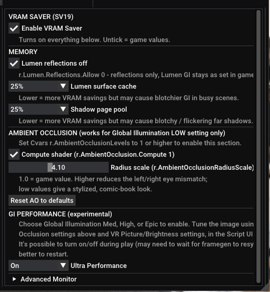
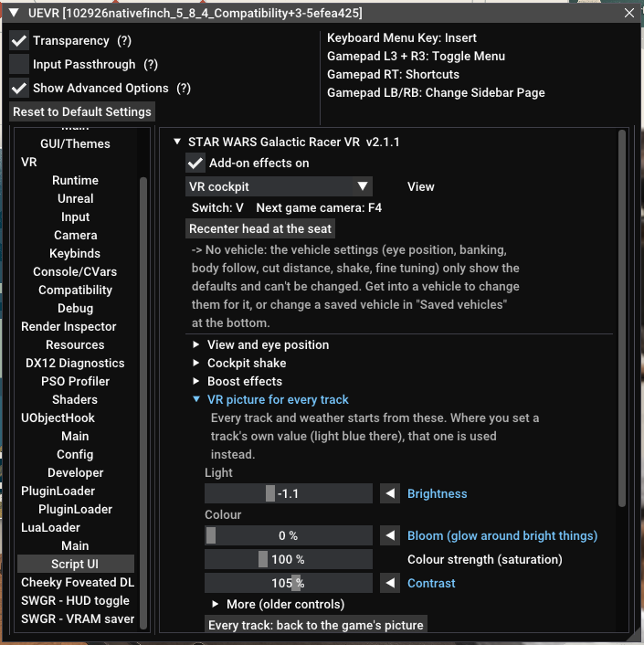
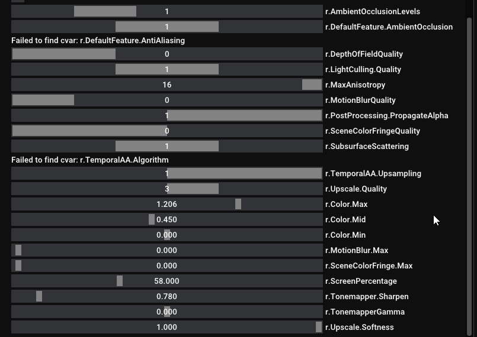

# Star Wars Galactic Racer – UEVR scripts

Two UEVR Lua scripts for **Star Wars Galactic Racer** (UE 5.7):

| Script | Version | Panel name in UEVR |
|---|---|---|
| `swgr_vram_saver.lua` | SV19 | **SWGR - VRAM saver** |
| `swgr_hud_toggle.lua` | HT29 | **SWGR - HUD toggle** |

Each script works on its own, so you can install one or both.

## ⬇️ Download

**[Download the scripts (zip)](https://github.com/TeamSnaxks/Star-Wars-Galactic-Racer-UEVR/archive/refs/heads/main.zip)**

You don't need a GitHub account. The link always gives you the latest version.

**Quick install:** open the zip, then open the `Star-Wars-Galactic-Racer-UEVR-main` folder inside it. Copy the `scripts` folder from there into `%APPDATA%\UnrealVRMod\SWGR-Win64-Shipping`. If Windows asks, choose to merge the folders. Then restart the game with UEVR. The full steps are below.

---

## Installing into your UEVR profile

1. **Run the game with UEVR once** so that a profile exists for it.
2. **Open the profile folder.** In the UEVR menu, click **Open Global Dir**, then open `SWGR-Win64-Shipping`. Alternatively, press `Win + R` and paste:
   ```
   %APPDATA%\UnrealVRMod\SWGR-Win64-Shipping
   ```
3. **Open the `scripts` folder** inside the profile. If it isn't there, create one called `scripts`.
4. **Copy the `.lua` files** into `scripts`:
   ```
   %APPDATA%\UnrealVRMod\SWGR-Win64-Shipping\scripts\swgr_vram_saver.lua
   %APPDATA%\UnrealVRMod\SWGR-Win64-Shipping\scripts\swgr_hud_toggle.lua
   ```
5. **Restart the game with UEVR.** The scripts load automatically. Their settings are saved in the profile's `data` folder (`swgr_vram_saver_sv9.json`, `swgr_hud_toggle.json`). That folder is created for you.
6. **Open the panels.** In the UEVR menu, go to **Script UI**. You'll see **SWGR - VRAM saver** and **SWGR - HUD toggle**.

To turn off a script without deleting it, rename it to end in `.lua.disabled`.

> If you share your profile as a zip, include the `scripts` folder. The `data` folder is optional, because it only holds your own settings.

---

## SWGR - VRAM saver (SV19)

This script lowers VRAM use and GPU load by changing a few Unreal renderer settings. It always puts back the game's own values when you untick an option or reset scripts.

**Important: it waits 30 seconds after launch before changing anything.** Changing settings while UEVR sets up the headset view, or during the intro movies, froze the game. After that, it applies one change every 0.5 s.

### Options

- **Enable VRAM Saver:** turns the whole panel on or off. Unticked, everything goes back to the game's values.
- **MEMORY**
  - *Lumen reflections off*: sets `r.Lumen.Reflections.Allow 0`. This turns off reflections only. Lumen GI stays as the game sets it.
  - *Lumen surface cache*: sets the size as a % of the game's value. Lower saves more VRAM, but GI can look blotchier in busy scenes.
  - *Shadow page pool*: sets the size as a % of the game's value. Lower saves more VRAM, but far shadows can look blotchy or flicker.
- **AMBIENT OCCLUSION**
  - This section only has an effect with in-game Global Illumination set to **Low**.
  - It stays locked until you set `r.AmbientOcclusionLevels` to 1 or higher on UEVR's **Cvars** page. The script never writes that value itself.
  - Options are the compute shader and a radius scale. A higher radius reduces the mismatch between the left and right eye.
- **GI PERFORMANCE (experimental)**
  - *Ultra Performance*: sets `r.Lumen.DiffuseIndirect.Allow 0`. This turns off Lumen GI the same way in-game GI Low does, while keeping your other GI-level settings.
  - It only works with in-game Global Illumination set to Medium, High or Epic.
  - You can switch it during play, but frame generation may need a moment to resync. Restarting is safer.
- **Advanced Monitor:** shows read-only game, target and live values, whether Lumen GI and reflections are running, and the most recent changes.

### Notes

- **Cvars page:** a value you set on UEVR's **Cvars** page always wins. The script stops fighting it and shows "held by Cvars page".
- **In-game graphics changes:** after changing graphics settings in the game, restart the game. Values a script has set stay locked until a restart.
- **Freeze troubleshooting:** every change is written to the UEVR log *before* it's sent, as lines starting with `[SWGR VRAM SAVER SV19] sending ...`. If the game freezes, the last line shows which change caused it.

### Recommended settings for Ultra Performance

Ultra Performance turns off Lumen GI, so the picture looks lighter and more bare. These are the settings I use to bring back depth and contrast. Set in-game **Global Illumination** to Medium, High or Epic.

**1. VRAM saver panel** (Script UI → SWGR - VRAM saver)

| Setting | Value |
|---|---|
| Enable VRAM Saver | on |
| Lumen reflections off | on |
| Lumen surface cache | 25% |
| Shadow page pool | 25% |
| Compute shader | on |
| Radius scale | 4.10 |
| Ultra Performance | On |



**2. VR picture** (Script UI → STAR WARS Galactic Racer VR → VR picture for every track)

| Setting | Value |
|---|---|
| Brightness | -1.1 |
| Bloom | 0 % |
| Colour strength (saturation) | 100 % |
| Contrast | 105 % |



**3. UEVR Cvars page** (Console/CVars)

`r.AmbientOcclusionLevels 1` is needed, because it unlocks the AMBIENT OCCLUSION section of the VRAM saver. The rest is my full Cvars page for reference. `r.ScreenPercentage` depends on your GPU and headset.

| Cvar | Value | | Cvar | Value |
|---|---|---|---|---|
| r.AmbientOcclusionLevels | 1 | | r.Color.Max | 1.206 |
| r.DefaultFeature.AmbientOcclusion | 1 | | r.Color.Mid | 0.450 |
| r.DepthOfFieldQuality | 0 | | r.Color.Min | 0.000 |
| r.LightCulling.Quality | 1 | | r.MotionBlur.Max | 0.000 |
| r.MaxAnisotropy | 16 | | r.SceneColorFringe.Max | 0.000 |
| r.MotionBlurQuality | 0 | | r.ScreenPercentage | 58 |
| r.PostProcessing.PropagateAlpha | 1 | | r.Tonemapper.Sharpen | 0.780 |
| r.SceneColorFringeQuality | 0 | | r.TonemapperGamma | 0.000 |
| r.SubsurfaceScattering | 1 | | r.Upscale.Softness | 1.000 |
| r.TemporalAA.Upsampling | 1 | | r.Upscale.Quality | 3 |



---

## SWGR - HUD toggle (HT29)

Press **L3** (left-stick click) during a race to fade the race HUD out or in. You can add a game UI sound for each.

- **Races only:** menus aren't affected. Every race starts with the HUD on.
- **Pause menu:** the toggle does nothing while the pause menu is open. If the HUD was hidden when you paused, it comes back when you resume. Press L3 again to hide it.
- **UEVR menu combo:** pressing L3 + R3 together (the UEVR menu combo) is ignored.

### Panel options

- *Enable HUD control*: the master switch.
- *Hide HUD*: does the same as L3, from the panel.
- *L3 toggles the HUD*: turns the button off for this session.
- *HUD opacity when on*: 20–100 %. 100 = the game's own opacity. Hidden is always fully invisible.
- *Fade-out / fade-in time*: 0–2 s. 0 = instant.
- *HUD off / HUD on sound*: a game UI sound with pitch and volume. Choosing a sound plays a preview.

---

## Requirements

- [UEVR](https://github.com/praydog/UEVR) with Lua scripting. A recent nightly build is recommended.
- Star Wars Galactic Racer (PC, `SWGR-Win64-Shipping.exe`).
